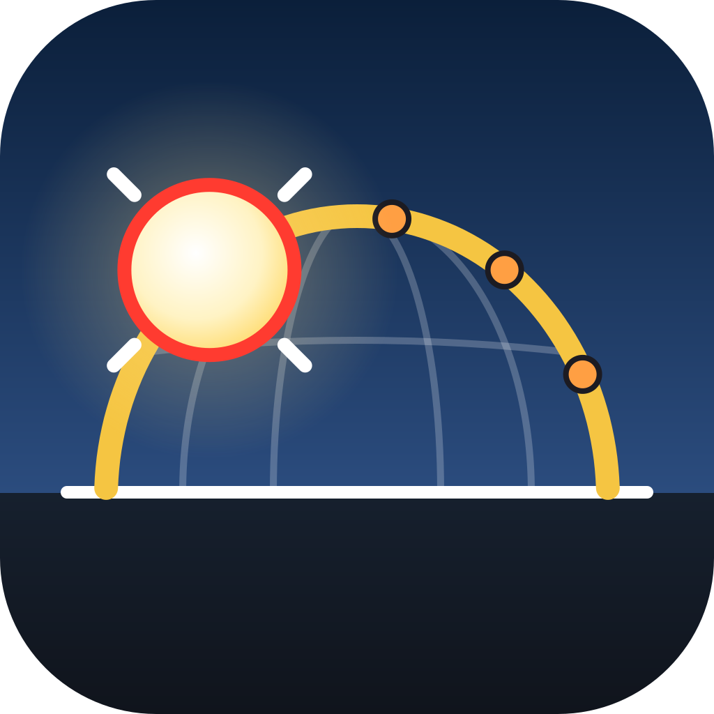

  

# Sun Tracker

An Android augmented reality app that shows where the sun is, or will be, on
the sky at your location.

It is free and open source under the [MIT license](LICENSE), with no ads and no
trackers. The app has no internet access at all, so your location and camera
view never leave your phone.

[Get it on Google Play][play]

## What it is for

Will your balcony get evening sun in the summer? Is the garden shaded by the
neighbor's house in spring? When does the sun reach the living room window in
winter? Hold up your phone and find out, before you buy the house, plant the
garden, put up solar panels or plan the photo shoot.

Chasing a sunset or getting up for a sunrise? Sun Tracker shows exactly where
on the horizon the sun will rise and set, and at what time. Scout your spot
ahead of time, see if a hill, tree or building will be in the way, and know
which way to point your camera.

## Features

- Camera view with an altitude and azimuth grid, the horizon and compass
  directions.
- The sun's path for the selected day with hourly markers, sunrise and sunset.
- The sun drawn as its real outline at true angular size. Pinch to zoom in on
  it, double tap to reset.
- Scrub the day and time rulers, or pick a date, to see any other time or
  season.
- An arrow at the screen edge points towards the sun when it is out of view.

Orientation comes from Android's fused rotation vector sensor through
[flutter_rotation_sensor][rotation], corrected to true north with the World
Magnetic Model from [geomag][geomag]. The camera's field of view is read from
the device. Both can be fine tuned in the calibration sheet.

The logo source files are in `assets/logo`.

[play]: https://play.google.com/store/apps/details?id=dev.spydon.sun_tracker
[rotation]: https://pub.dev/packages/flutter_rotation_sensor
[geomag]: https://pub.dev/packages/geomag
